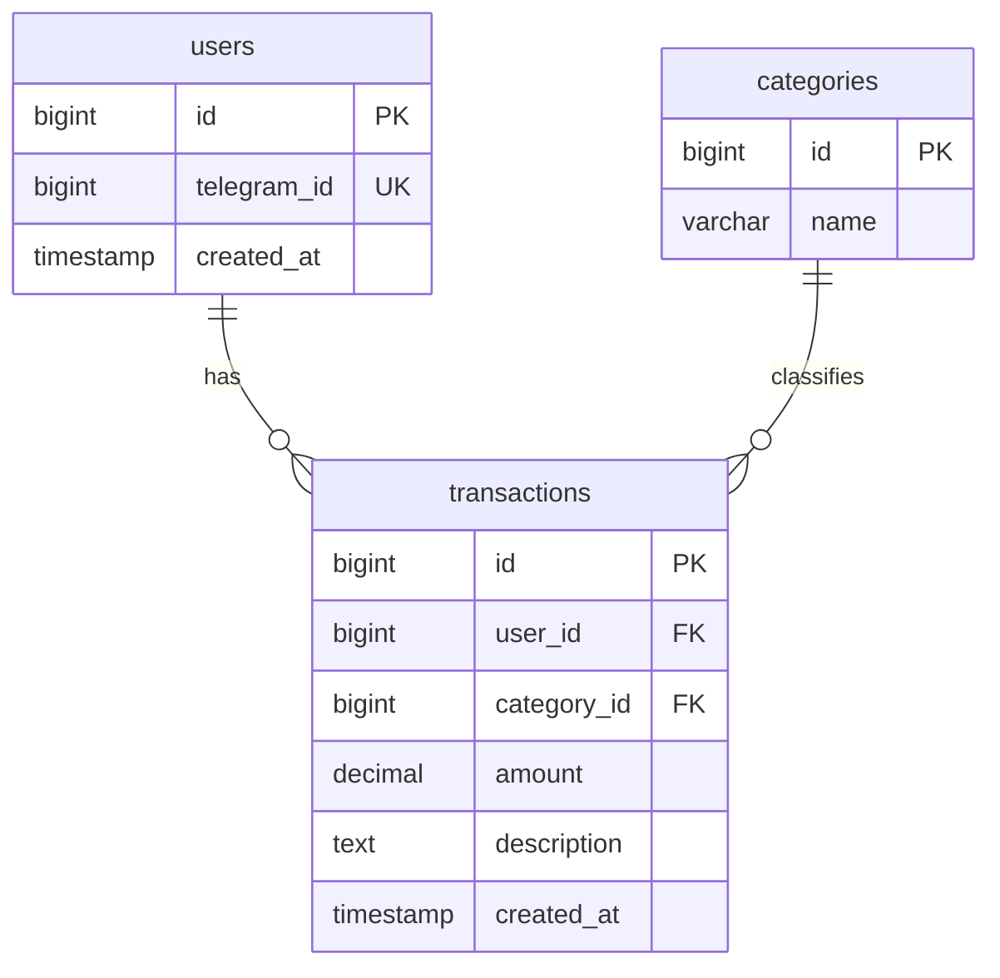

# Lesson 6: Database Design

## 1. Purpose

This document describes the proposed PostgreSQL database structure for our educational financial Telegram bot.

The database will store Telegram users, expense categories, and financial transactions.

We plan to use Neon PostgreSQL with SQLAlchemy 2.0 async and asyncpg.

**Current status:** The owner confirmed the Neon connection, existing tables and
persistent user storage. Expense code is prepared but requires the unapplied
schema migration before deployment. Tests have not been run.
See [current expense implementation](expense.md).
The remaining text describes the original design and historical plan.

## 2. Database Tables

The initial database consists of three tables:

- `users` — stores Telegram users.
- `categories` — stores expense categories.
- `transactions` — stores financial transactions.

## 3. Users Table

The `users` table stores information about people who interact with the Telegram bot.

| Field | Type | Description |
|---|---|---|
| id | BIGINT | Primary key |
| telegram_id | BIGINT | Unique Telegram user identifier |
| created_at | TIMESTAMP | Date and time when the user was created |

The `telegram_id` field must be unique.

One user can have multiple transactions.

## 4. Categories Table

The `categories` table groups financial transactions by type.

| Field | Type | Description |
|---|---|---|
| id | BIGINT | Primary key |
| name | VARCHAR(100) | Category name |

Example categories:

- Food
- Transport
- Shopping
- Entertainment
- Other

One category can be associated with multiple transactions.

## 5. Transactions Table

The `transactions` table stores individual expense records.

| Field | Type | Description |
|---|---|---|
| id | BIGINT | Primary key |
| user_id | BIGINT | Foreign key referencing users.id |
| category_id | BIGINT | Foreign key referencing categories.id |
| amount | NUMERIC(12,2) | Expense amount |
| description | TEXT | Expense description |
| created_at | TIMESTAMP | Date and time of the transaction |

The `amount` field should contain a positive value.

Each transaction belongs to one user and one category.

## 6. Relationships

The database has two main relationships:

1. **users → transactions:** one-to-many. One user can create multiple transactions.
2. **categories → transactions:** one-to-many. One category can be assigned to multiple transactions.

Foreign keys:

- `transactions.user_id` references `users.id`.
- `transactions.category_id` references `categories.id`.

These relationships help maintain data consistency.

## 7. Entity Relationship Diagram

The following Mermaid diagram illustrates the proposed database structure:

## 8. Example: Recording an Expense

The user sends the following Telegram command:

`/expense 120 кава`

The expected processing flow is:

1. Telegram sends the message to the bot.
2. The aiogram backend receives and parses the command.
3. The application identifies the Telegram user.
4. The application selects or creates the appropriate category.
5. SQLAlchemy saves the transaction in PostgreSQL.
6. The bot sends a confirmation message.

Example transaction:

| Field | Example |
|---|---|
| user_id | 1 |
| category_id | 1 |
| amount | 120.00 |
| description | кава |
| created_at | Automatically generated timestamp |

The exact category selection rules will be determined during implementation.

## 9. Database Security

Database credentials must be stored securely.

- Keep `DATABASE_URL` in the local `.env` file.
- Never hardcode database passwords in Python files.
- Never commit real connection strings to Git.
- Use `.env.example` for safe configuration placeholders.
- Avoid printing credentials in application logs.
- Rotate credentials if they are exposed.

The database schema is documentation and does not contain credentials.

## 10. Planned Implementation

The next development steps are:

1. Create a PostgreSQL project in Neon.
2. Configure the local `DATABASE_URL`.
3. Add SQLAlchemy 2.0 async and asyncpg.
4. Test the database connection using `SELECT 1`.
5. Create the required database tables.
6. Implement the `/expense` command.
7. Verify that transactions are saved correctly.
8. Confirm that `/start` and `/help` still work.

## Conclusion

The proposed database structure provides a foundation for storing financial transactions in our Telegram bot.

The `users`, `categories`, and `transactions` tables will allow the application to associate expenses with users and categories.

The structure may be refined during implementation while preserving secure credential management.
